# ShopSphere
## An Online E-commerce Shopping Platform

### BSc CSIT — Sixth Semester Project Report

| Submission detail | Information |
|---|---|
| Student name | `[Student Name]` |
| Roll number | `[Roll Number]` |
| College | `[College Name]` |
| Department | Department of Computer Science and Information Technology |
| University | `[University Name]` |
| Academic year | `[Academic Year]` |

Submitted in partial fulfillment of the requirements for the Bachelor of Science in Computer Science and Information Technology (BSc CSIT).

---

## Abstract

ShopSphere is an ASP.NET Core MVC web application that demonstrates the principal workflows of an online retail store. Customers can create an account, browse and search a product catalog, filter and sort products, maintain a guest or signed-in shopping cart, and place a Cash on Delivery (COD) order. Customers can view their own orders and cancel an eligible pending order. An administrator can manage products, categories, inventory and order status, review customer records and view store statistics.

The application is implemented in C# on .NET 10. Entity Framework Core 10.0.11 connects the MVC application to Microsoft SQL Server. ASP.NET Core Identity manages accounts, password hashing, authentication cookies and the Customer and Admin roles. The database contains catalog, cart and order entities together with the standard Identity tables. Order items retain product name, image and price snapshots so historical order records do not depend on later catalog edits.

The checkout workflow is limited to Cash on Delivery. The application does not connect to an online payment gateway or a delivery carrier. The report describes the source code and behavior inspected for this project; execution results are limited to the manual workflow, build, database and responsive checks recorded in Chapter 8. The screenshots in Chapter 7 were captured from a separate local Development database populated with sample data.

---

# Chapter 1 — Introduction

## 1.1 Background

Online retail applications provide a digital storefront where customers can discover products, compare prices, assemble an order and review its status. A useful academic implementation must coordinate a user interface, application logic, identity management and persistent data while keeping customer and administrator operations appropriately separated.

ShopSphere applies the Model–View–Controller (MVC) pattern to this problem. Razor views render the storefront and administration pages; controllers process HTTP requests; services encapsulate cart, order, seeding and upload operations; and Entity Framework Core persists data in SQL Server. The storefront uses Nepalese Rupee (NPR) prices and sample product data relevant to the project’s Nepal-facing presentation.

## 1.2 Problem statement

A static product page cannot support a complete retail workflow. A store needs a persistent catalog, search and category navigation, price and availability filters, a user-owned cart, server-validated order placement, stock updates and an administrative interface. It must also keep order history accurate when a product’s name, image or price later changes.

ShopSphere addresses these needs as a functional academic prototype. It does not claim to be a deployed commercial marketplace or to include third-party payment and delivery integrations.

## 1.3 Objectives

The project objectives are to:

1. Provide a responsive storefront for product discovery and category browsing.
2. Support product-name, description and category search, plus server-side filters, sorting and pagination.
3. Allow guest and authenticated customers to maintain a cart while checking current price and stock on the server.
4. Support customer registration, login, profile updates, order history and eligible order cancellation.
5. Place COD orders transactionally, snapshot purchased product information, update stock and prevent duplicate submissions.
6. Provide role-protected administrator workflows for product, category, inventory, customer and order management.
7. Persist application records in SQL Server through Entity Framework Core migrations.

## 1.4 Project scope

### Included

- Storefront homepage, categories, product catalog and product details.
- Product search, price/category/availability filtering, sorting and pagination.
- ASP.NET Core Identity accounts and the `Customer` and `Admin` roles.
- Customer profile updates and user-owned order views.
- Guest and signed-in shopping carts, including guest-cart merge after sign-in.
- COD checkout, order confirmation, order history and order cancellation rules.
- Admin dashboard, product and category management, local product-image uploads, customer read views, order search/filtering and status updates.
- Development-only sample catalog seeding and optional environment-configured bootstrap administrator.

### Excluded or not integrated

- Online payment processing, payment-provider callbacks or refunds.
- Courier integration, delivery tracking, shipping-rate calculation or delivery-fee collection.
- Product reviews or a persisted rating system.
- Automated email confirmation, password-reset or external sign-in workflows.
- Customer account deletion or administrative editing/deletion of customer accounts.
- A production deployment, production performance target or production database verification.

Detailed functional limits are listed in Sections 1.5, 5 and 10.

## 1.5 Project limitations

1. COD is the only supported payment method. Payment status is initialized as Pending; no payment gateway or payment-status processing workflow is present.
2. Guest carts are supported, but checkout requires an authenticated customer.
3. There is no courier integration, tracking feed, delivery-fee calculation, return workflow or refund workflow.
4. Product cards display a “rating not available”/new placeholder; there are no reviews or rating records.
5. The account screens do not provide email confirmation, password reset or social sign-in.
6. The Admin area provides customer viewing, not customer account editing or deletion.
7. The privacy page remains template content. Some promotional copy (including easy returns) is not backed by a corresponding application workflow.
8. “Flash deals” are products with a qualifying discount, not time-limited promotions. “Popular right now” uses product creation order rather than sales analytics.
9. The source repository contains no automated test project. Reported workflow and responsive results are manual checks, not a penetration test.
10. Development sample data is not production data. Product image URLs that point to external hosts depend on those hosts remaining available.

---

# Chapter 2 — Feasibility Study

## 2.1 Technical feasibility

The implemented stack is suitable for a database-backed MVC application: .NET 10, ASP.NET Core MVC, ASP.NET Core Identity, Entity Framework Core 10.0.11 and the EF Core SQL Server provider. The application uses dependency injection for its database context and services. Existing EF migrations define the schema, and the current Development run was built and started against an isolated SQL Server database for screenshots.

The project is technically feasible for local academic development when a compatible .NET 10 SDK and SQL Server instance are available. Production deployment, concurrent-load behavior, disaster recovery and payment or courier integrations were not measured by this project.

## 2.2 Economic feasibility

The application does not require a paid payment gateway or carrier integration for its current COD workflow. The .NET and EF Core software stack is available without a per-request fee. SQL Server edition, hosting, domain, backup, monitoring and production support costs depend on the deployment selected by the institution or project owner and are outside the tested scope. A local academic setup can use an appropriately licensed SQL Server edition and development tools.

## 2.3 Operational feasibility

Customers use browser pages for product discovery, carts, checkout and order history. Administrators use a role-protected Admin area to manage the catalog and orders. No special end-user software is required beyond a browser. In an operational deployment, staff would still need to coordinate COD collection and delivery manually because external payment and carrier systems are not connected.

---

# Chapter 3 — Requirement Analysis

## 3.1 Functional requirements

| ID | Requirement |
|---|---|
| FR-01 | A visitor can browse the homepage, categories, products and product details. |
| FR-02 | A visitor can search by product name, description or category name. |
| FR-03 | A visitor can filter by category, discounted price range and stock availability, sort the results and navigate pages. |
| FR-04 | A visitor can create an account; registration assigns the Customer role and signs in the new customer. |
| FR-05 | A customer can log in, log out, choose Remember me and update their name and phone number. |
| FR-06 | A guest or customer can add products to a cart, change quantity, remove items and clear the cart, subject to stock validation. |
| FR-07 | After sign-in, a guest cart can be merged into the customer cart with duplicate products and stock limits handled by the service. |
| FR-08 | An authenticated customer can place a COD order using delivery details, view their own order history and details, and cancel an eligible pending order. |
| FR-09 | Order placement records snapshots, checks current price and stock, decrements inventory and clears the cart transactionally. |
| FR-10 | An Admin can view dashboard statistics and recent orders, customers and low-stock information. |
| FR-11 | An Admin can create, view, edit and delete products; assign categories; update prices, discounts and stock; and upload product images. |
| FR-12 | An Admin can create, view, edit and safely delete categories; deletion is blocked when products still use the category. |
| FR-13 | An Admin can search/filter orders, view delivery information and apply permitted order-status transitions. Cancellation restores stock once. |
| FR-14 | An Admin can view customer records and a customer’s order history; customer records are not editable/deletable in the Admin UI. |

## 3.2 Non-functional requirements and implemented controls

| Area | Requirement / implementation evidence |
|---|---|
| Security | ASP.NET Core Identity stores password hashes; Admin controllers use role authorization; customer order endpoints require the Customer role. |
| Request integrity | Mutating forms use antiforgery protection. |
| Validation | View models/data annotations and server-side checks validate input; business-critical price and stock values are read from SQL Server. |
| Data integrity | Foreign keys, unique indexes, quantity/owner/status checks and explicit delete behavior are configured in the EF model. |
| Consistency | Order placement, cancellation and status changes use database transactions in the order service. |
| Responsiveness | Storefront and Admin views use responsive layouts; Phase 8 recorded manual checks at 1440, 1366, 768 and 390 CSS pixels. |
| Performance | Product queries use database-side filtering/sorting/pagination, and relevant database operations are asynchronous. |
| Maintainability | Controllers, data context, services, view models, view components and Razor views follow the existing MVC structure. |
| Availability | No uptime or disaster-recovery service-level target was defined or tested. |

## 3.3 Hardware requirements

The repository does not enforce hardware requirements, and the test machine’s hardware specification was not recorded. The following is a **suggested local development baseline**, not a measured minimum:

| Component | Suggested baseline |
|---|---|
| Processor | 64-bit, dual-core or better |
| Memory | 8 GB RAM or more when running an IDE, the application and local SQL Server together |
| Storage | 5 GB of free space for SDK/tooling and database files, excluding any separately stored product-image collection |
| Display | 1366 × 768 or higher; responsive UI checks were performed at the widths listed in Chapter 8 |
| Network | Access to the selected SQL Server instance; internet access may be needed for external product images or package restore |

## 3.4 Software requirements

| Software | Role |
|---|---|
| Windows or another .NET-supported operating system | Development/runtime host |
| .NET 10 SDK | Build and run the `net10.0` application |
| Microsoft SQL Server | Persistent relational database |
| EF Core CLI 10.0.11-compatible tool | Apply the included migrations |
| Modern browser | Customer and Admin UI |
| ASP.NET Core MVC / Razor | Web application and views |
| ASP.NET Core Identity | Account, password and role management |
| Entity Framework Core SQL Server 10.0.11 | ORM and database provider |
| HTML, CSS, JavaScript and Bootstrap 5 | User interface |

The project package versions and target framework are recorded in [`ShopSphere.csproj`](../ShopSphere.csproj).

---

# Chapter 4 — System Design

## 4.1 System architecture

ShopSphere uses a server-rendered MVC architecture. A browser sends HTTP requests to ASP.NET Core. Middleware handles routing, authentication, authorization, static files and antiforgery support. MVC controllers validate request data and coordinate with application services and `ShopSphereDbContext`. EF Core translates database queries and updates to SQL Server. Razor views render HTML for the browser.

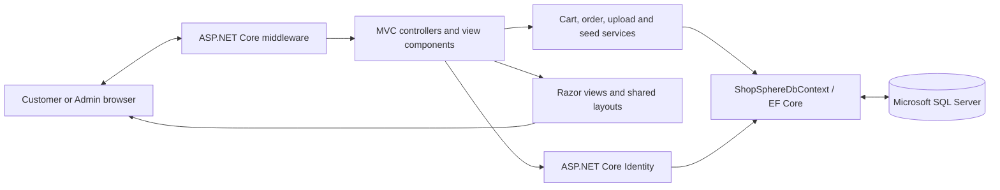

The principal startup and persistence files are [`Program.cs`](../Program.cs), [`Data/ShopSphereDbContext.cs`](../Data/ShopSphereDbContext.cs) and [`Migrations/`](../Migrations/). The application does not automatically apply migrations at startup; database setup is described in [`README.md`](README.md).

## 4.2 MVC architecture

- **Model:** persistent entities such as Product, Category, Cart, CartItem, Order, OrderItem and ApplicationUser; view models represent form and page data.
- **View:** Razor pages under `Views/` and `Areas/Admin/Views/`, including shared layouts and product-card partials.
- **Controller:** storefront/account/cart/order controllers and Admin-area controllers receive requests, enforce access rules, validate input and return views or redirects.
- **Service:** business logic such as cart ownership/merging, order transactions, development seeding, role initialization and image validation is placed in injected services.
- **Data access:** `ShopSphereDbContext` derives from the Identity EF context, maps the domain relationships and configures indexes, precision and constraints for SQL Server.

## 4.3 Use case diagram

The source diagram is [`diagrams/Use_Case_Diagram.mmd`](diagrams/Use_Case_Diagram.mmd). It reflects customer and Admin actions present in the inspected application. Checkout and customer order pages require an authenticated Customer; the Admin area requires the Admin role.

## 4.4 Data flow diagrams

The Level 0 context view and Level 1 process/data-store view are in [`diagrams/DFD.mmd`](diagrams/DFD.mmd). They show the browser actors, MVC application, Identity/catalog/cart/order data and SQL Server. There is intentionally no payment-provider or delivery-carrier flow because the application does not integrate either system.

## 4.5 Entity-relationship diagram

The complete Mermaid ER diagram source is [`diagrams/ERD.mmd`](diagrams/ERD.mmd). It includes the standard Identity tables and the six application domain tables. A cart may be customer-owned or guest-owned; its database constraint requires exactly one of those ownership modes.

---

# Chapter 5 — Implementation

## 5.1 Technology descriptions

| Technology | Use in ShopSphere |
|---|---|
| C# / .NET 10 | Application language and runtime; project target is `net10.0`. |
| ASP.NET Core MVC | Routing, controllers, model binding and server-rendered views. |
| Razor | Dynamic HTML views and shared components. |
| ASP.NET Core Identity | Users, password hashing, authentication cookies and role membership. |
| Entity Framework Core 10.0.11 | Object-relational mapping, asynchronous queries, transactions and migrations. |
| Microsoft SQL Server | Relational persistence for Identity, catalog, carts and orders. |
| HTML, CSS and JavaScript | Page structure, styling and browser interactions. |
| Bootstrap 5 | Responsive layout and common UI styling, alongside project-specific CSS. |

## 5.2 Application modules

### Storefront and catalog

The homepage queries categories and selected in-stock products from SQL Server. It shows up to four in-stock products discounted by at least 30% as flash deals, and up to eight in-stock products with discounts below 30% in the popular section; the latter are selected by creation date, not sales volume. The catalog searches product name, description and category name, applies category, availability and discounted-price filters, supports four sort modes and paginates 12 results per page in the database. Product details show the category, image, current price, original price, stock and related products.

### Authentication and account

Registration validates account fields, creates an Identity user with a hashed password, assigns the Customer role and signs the user in. Login checks email/password, supports Remember me and only honors a local return URL. Customer profile pages allow the authenticated user to update their own name and phone number. The role and authentication setup is configured in [`Program.cs`](../Program.cs), while account actions are in [`Controllers/AccountController.cs`](../Controllers/AccountController.cs).

The default Identity roles are `Customer` and `Admin`. Role initialization runs at application startup. A bootstrap administrator can be configured through `BootstrapAdmin:Email`, `BootstrapAdmin:Password` and optional `BootstrapAdmin:FullName`; the password is not stored in committed source. Admin controllers are protected by role-based authorization.

### Product and category management

Admin users can search and paginate products, view details, create/edit products, update pricing/discounts and stock, assign a category and delete a product when allowed by its relationships. Image uploads are written under the web root using generated filenames; the implementation accepts JPEG, PNG or WebP content and limits uploads to 5 MB. Category images use URL/path values rather than the product upload workflow. Category deletion is prevented when the category still has products.

### Shopping cart

Guests receive a random 32-byte cart cookie token; the database stores a hashed guest key, not the raw cookie token. The guest cookie lifetime is 30 days. Signed-in customers have a user-owned cart. Cart operations re-read current product and stock data and do not accept client-supplied prices. When a guest signs in or registers, the guest cart is merged into the customer cart; duplicate items and stock ceilings are reconciled in the cart service.

### Checkout workflow

1. A customer must be authenticated and have cart items.
2. The checkout page collects customer name, phone and delivery address fields; the current payment option is COD.
3. On submission, the server re-reads current products, prices and stock rather than trusting browser totals.
4. The order service uses a serializable database transaction, validates stock, creates the Order and OrderItem snapshot records, decrements inventory and clears the cart.
5. A submission token and unique `(UserId, SubmissionToken)` index prevent duplicate order creation on a repeated submission.
6. A successful order starts with Pending order status and Pending payment status. The customer sees an order number and can view the order history/detail.

No online payment is charged or simulated. The total is based on product subtotals; no delivery fee is stored or added by the current implementation.

### Order processing and cancellation

The permitted administrator transitions are:

| Current status | Permitted next status |
|---|---|
| Pending | Confirmed or Cancelled |
| Confirmed | Processing or Cancelled |
| Processing | Shipped or Cancelled |
| Shipped | Delivered |
| Delivered | Terminal |
| Cancelled | Terminal |

A customer may cancel only their own Pending order. Cancellation and inventory restoration occur transactionally and are guarded to avoid restoring the same order’s stock more than once. Deleting a product leaves order snapshots intact by setting the historical `ProductId` to null.

### Administrator workflow

Admins use a separate layout and sidebar for dashboard, products, categories, orders and customers. Dashboard values are queried from SQL Server. Revenue is calculated from Delivered orders; pending orders and low-stock items (stock quantity at or below 5) are separately shown. Customer pages are read-only and can show that customer’s order history. Admin access is enforced on the server through role authorization, not merely by hiding navigation links.

---

# Chapter 6 — Database Design

## 6.1 Database context and migrations

[`ShopSphereDbContext`](../Data/ShopSphereDbContext.cs) derives from `IdentityDbContext<ApplicationUser>`. It adds the six domain entity sets and configures foreign keys, delete behavior, decimal precision, indexes and database check constraints. Four migrations are present:

1. `20261115151547_InitialCreate`
2. `20261116075233_AddIdentity`
3. `20261116140930_AddShoppingCart`
4. `20261116143024_AddOrders`

The model snapshot is [`ShopSphereDbContextModelSnapshot.cs`](../Migrations/ShopSphereDbContextModelSnapshot.cs). When migrations are applied, EF Core also creates `__EFMigrationsHistory`; this framework table is not an application entity.

## 6.2 Domain entities

### Categories

| Attribute | SQL type | Key / nullability | Description |
|---|---|---|---|
| CategoryId | int identity | PK, NOT NULL | Category identifier |
| CategoryName | nvarchar(80) | NOT NULL | Required unique category name |
| Description | nvarchar(500) | NULL | Optional category description |
| ImageUrl | nvarchar(2048) | NOT NULL | Category image URL or app path |

`CategoryName` has a unique index. Deleting a category referenced by products is restricted.

### Products

| Attribute | SQL type | Key / nullability | Description |
|---|---|---|---|
| ProductId | int identity | PK, NOT NULL | Product identifier |
| ProductName | nvarchar(160) | NOT NULL | Product name |
| Description | nvarchar(2000) | NOT NULL | Product description |
| Price | decimal(18,2) | NOT NULL | Original/base price |
| DiscountPercentage | decimal(5,2) | NOT NULL | Discount percentage |
| StockQuantity | int | NOT NULL | Current stock |
| ImageUrl | nvarchar(2048) | NOT NULL | Product image reference |
| CategoryId | int | FK, NOT NULL | References `Categories.CategoryId` |
| CreatedAt | datetime2 | NOT NULL | Creation time; database default is `GETUTCDATE()` |

Indexes support category lookup, creation-date ordering and `(DiscountPercentage, StockQuantity)` queries. Category deletion uses RESTRICT/NO ACTION. Data annotations validate price, discount, stock and string lengths; those numeric ranges are not all duplicated as SQL check constraints.

### Carts

| Attribute | SQL type | Key / nullability | Description |
|---|---|---|---|
| CartId | int identity | PK, NOT NULL | Cart identifier |
| UserId | nvarchar(450) | FK, NULL | Signed-in cart owner |
| GuestCartKey | nvarchar(64) | NULL | Hash key for a guest cart |
| CreatedAt | datetime2 | NOT NULL | Creation timestamp; default `GETUTCDATE()` |
| UpdatedAt | datetime2 | NOT NULL | Last update timestamp; default `GETUTCDATE()` |

`CK_Carts_OneOwner` requires exactly one owner: either `UserId` or `GuestCartKey`. Filtered unique indexes on non-null `UserId` and `GuestCartKey` allow at most one cart for each owner. User deletion cascades to that user’s cart.

### CartItems

| Attribute | SQL type | Key / nullability | Description |
|---|---|---|---|
| CartItemId | int identity | PK, NOT NULL | Cart-line identifier |
| CartId | int | FK, NOT NULL | References `Carts.CartId` |
| ProductId | int | FK, NOT NULL | References `Products.ProductId` |
| Quantity | int | NOT NULL | Positive quantity |
| AddedAt | datetime2 | NOT NULL | Add time; default `GETUTCDATE()` |

`(CartId, ProductId)` is unique, `ProductId` is indexed, and `CK_CartItems_Quantity` requires quantity greater than zero. Deleting a cart cascades to its items; deleting a referenced product is restricted.

### Orders

| Attribute | SQL type | Key / nullability | Description |
|---|---|---|---|
| OrderId | int identity | PK, NOT NULL | Order identifier |
| OrderNumber | nvarchar(32) | NOT NULL, unique | Human-readable order number |
| UserId | nvarchar(450) | FK, NOT NULL | References `AspNetUsers.Id` |
| OrderDate | datetime2 | NOT NULL | Order time; default `GETUTCDATE()` |
| TotalAmount | decimal(18,2) | NOT NULL | Server-calculated order total |
| CustomerName | nvarchar(120) | NOT NULL | Delivery contact name snapshot |
| PhoneNumber | nvarchar(32) | NOT NULL | Delivery contact phone snapshot |
| Province | nvarchar(100) | NOT NULL | Delivery province |
| District | nvarchar(100) | NOT NULL | Delivery district |
| City | nvarchar(100) | NOT NULL | Delivery municipality/city |
| StreetAddress | nvarchar(300) | NOT NULL | Street address |
| DeliveryInstructions | nvarchar(500) | NULL | Optional delivery instructions |
| PaymentMethod | nvarchar(32) | NOT NULL | Currently `CashOnDelivery` |
| PaymentStatus | nvarchar(32) | NOT NULL | Initially `Pending` |
| OrderStatus | nvarchar(32) | NOT NULL | Initial state `Pending` |
| SubmissionToken | uniqueidentifier | NOT NULL | Idempotency token |

Unique indexes cover `OrderNumber` and `(UserId, SubmissionToken)`; `(UserId, OrderDate)` is indexed for customer history. `CK_Orders_OrderStatus` limits the order status to Pending, Confirmed, Processing, Shipped, Delivered or Cancelled. `CK_Orders_PaymentStatus` limits payment status to Pending, Paid or Refunded. `CK_Orders_PaymentMethod` allows only CashOnDelivery. User deletion is restricted while orders reference the user.

### OrderItems

| Attribute | SQL type | Key / nullability | Description |
|---|---|---|---|
| OrderItemId | int identity | PK, NOT NULL | Order-line identifier |
| OrderId | int | FK, NOT NULL | References `Orders.OrderId` |
| ProductId | int | FK, NULL | Optional reference to current product |
| ProductName | nvarchar(160) | NOT NULL | Name snapshot at purchase |
| ProductImageUrl | nvarchar(2048) | NOT NULL | Image snapshot at purchase |
| Quantity | int | NOT NULL | Purchased quantity |
| UnitPrice | decimal(18,2) | NOT NULL | Purchase-time unit price |
| Subtotal | decimal(18,2) | NOT NULL | Purchase-time line subtotal |

`OrderId` and `ProductId` are indexed. `CK_OrderItems_Quantity` requires quantity greater than zero. Deleting an order cascades to its items; deleting a product sets `ProductId` to null while preserving the snapshot.

## 6.3 ASP.NET Core Identity tables

The seven Identity tables are part of the actual EF model and migration. Identity columns not marked nullable below are NOT NULL in the SQL Server schema. The key `Id` values are `nvarchar(450)` unless stated otherwise.

| Table | Attributes and SQL types | Primary key, foreign keys and indexes |
|---|---|---|
| `AspNetUsers` | `Id nvarchar(450)`; Identity fields `UserName nvarchar(256)`, `NormalizedUserName nvarchar(256)`, `Email nvarchar(256)`, `NormalizedEmail nvarchar(256)`, `PasswordHash nvarchar(max)`, `SecurityStamp nvarchar(max)`, `ConcurrencyStamp nvarchar(max)`, `PhoneNumber nvarchar(max)`, `LockoutEnd datetimeoffset`; booleans `EmailConfirmed`, `PhoneNumberConfirmed`, `TwoFactorEnabled`, `LockoutEnabled`; `AccessFailedCount int`; custom `FullName nvarchar(120)` and `CreatedAt datetime2` (default `GETUTCDATE()`). The string fields listed without a required marker and `LockoutEnd` are nullable; booleans, `AccessFailedCount`, `FullName`, and `CreatedAt` are NOT NULL. | PK `Id`; `EmailIndex` on `NormalizedEmail` is non-unique; filtered unique `UserNameIndex` on non-null `NormalizedUserName`. |
| `AspNetRoles` | `Id nvarchar(450)`; nullable `Name nvarchar(256)`, `NormalizedName nvarchar(256)`, `ConcurrencyStamp nvarchar(max)`. | PK `Id`; filtered unique `RoleNameIndex` on non-null `NormalizedName`. |
| `AspNetRoleClaims` | `Id int` identity; `RoleId nvarchar(450)`; nullable `ClaimType nvarchar(max)`, `ClaimValue nvarchar(max)`. | PK `Id`; index and cascading FK `RoleId` → `AspNetRoles.Id`. |
| `AspNetUserClaims` | `Id int` identity; `UserId nvarchar(450)`; nullable `ClaimType nvarchar(max)`, `ClaimValue nvarchar(max)`. | PK `Id`; index and cascading FK `UserId` → `AspNetUsers.Id`. |
| `AspNetUserLogins` | `LoginProvider nvarchar(450)`, `ProviderKey nvarchar(450)`, `UserId nvarchar(450)`; nullable `ProviderDisplayName nvarchar(max)`. | Composite PK `(LoginProvider, ProviderKey)`; index and cascading FK `UserId` → `AspNetUsers.Id`. |
| `AspNetUserRoles` | `UserId nvarchar(450)`, `RoleId nvarchar(450)`. | Composite PK `(UserId, RoleId)`; `RoleId` index; both user and role foreign keys cascade. |
| `AspNetUserTokens` | `UserId nvarchar(450)`, `LoginProvider nvarchar(450)`, `Name nvarchar(450)`; nullable `Value nvarchar(max)`. | Composite PK `(UserId, LoginProvider, Name)`; cascading FK `UserId` → `AspNetUsers.Id`. |

The configured Identity option requires unique email at the application layer, but the generated `EmailIndex` is not a unique database index. The database therefore does not independently enforce that rule for writes made outside the Identity application workflow.

## 6.4 Relationships, integrity and indexes

| Relationship | Cardinality / delete behavior |
|---|---|
| Category → Product | One category has many products; product FK is required; category deletion is restricted. |
| ApplicationUser → Cart | A user can own a cart; cart `UserId` is nullable because a guest cart instead has a `GuestCartKey`; user deletion cascades to the cart. |
| Cart → CartItem | One cart has multiple items; cart deletion cascades to items. |
| Product → CartItem | A product may appear in multiple cart items; deletion is restricted while cart items reference it. |
| ApplicationUser → Order | A customer may have multiple orders; order user FK is required; user deletion is restricted. |
| Order → OrderItem | An order has one or more order-line snapshots; order deletion cascades to lines. |
| Product → OrderItem | Historical product reference is optional; product deletion sets the FK to null and leaves snapshots. |
| Identity users/roles → claims, logins, role mappings and tokens | Identity-managed foreign keys and cascades as specified in Section 6.3. |

The model uses database checks for cart ownership, positive cart/order-item quantities, allowed order/payment state values and COD-only payment method. Application data annotations and service validation cover other field and business-rule constraints. The order service calculates the order total from item snapshots; no SQL check compares `TotalAmount` with the sum of `OrderItems`.

---

# Chapter 7 — User Interface

The following actual browser screenshots were captured on 16 November 2026 from the current source, running in Development against a separate documentation-only SQL Server database. That database was migrated and seeded with six categories and 18 sample products; a temporary customer placed one COD order so order-related views would contain data. Screenshots do not use the project owner’s personal database. Screen captures show the local desktop presentation; responsive viewport testing is summarized in Chapter 8.

### Figure 7.1 — Homepage

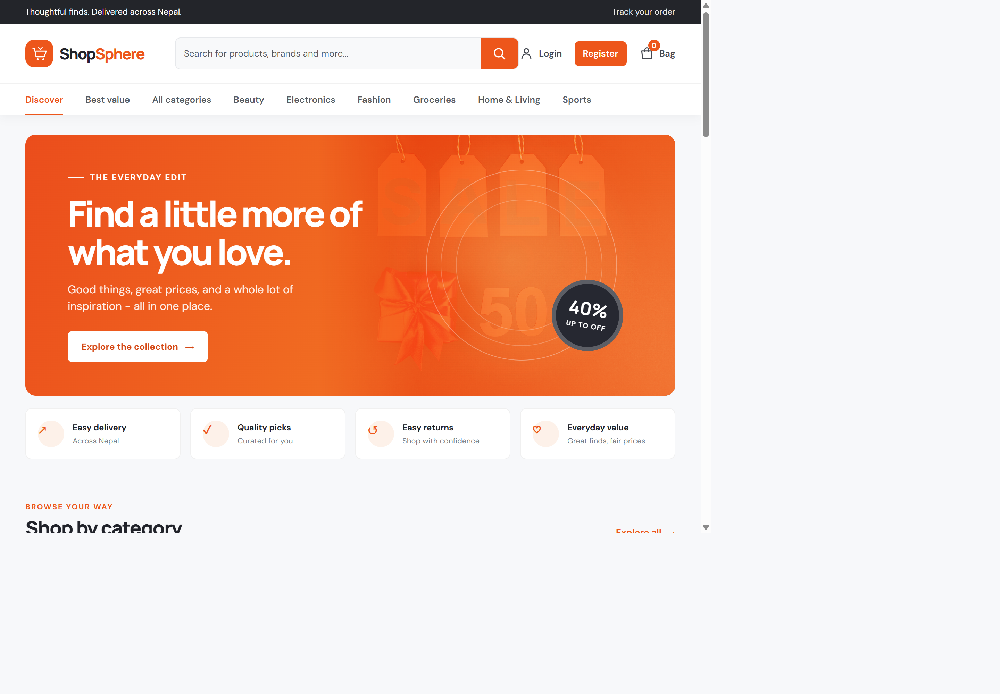

### Figure 7.2 — Product listing

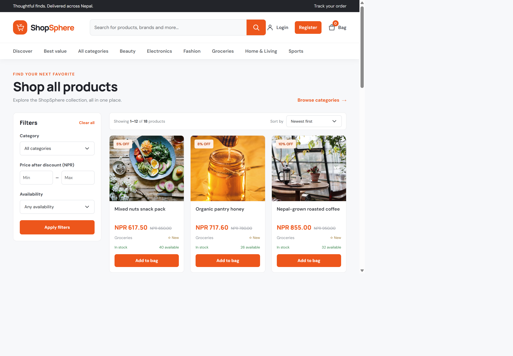

### Figure 7.3 — Product details

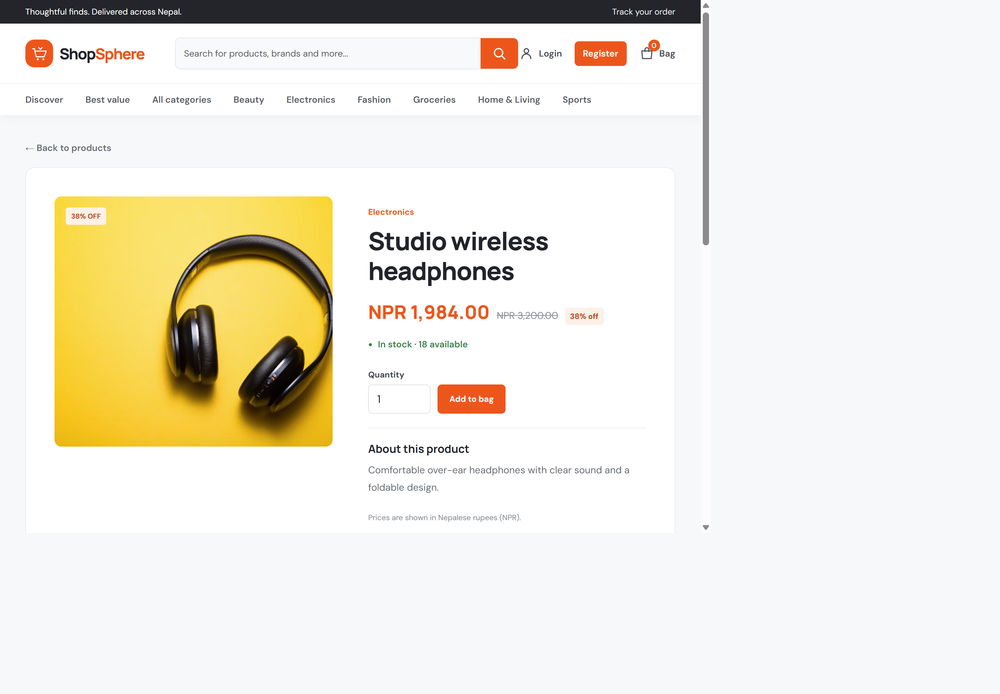

### Figure 7.4 — Customer login

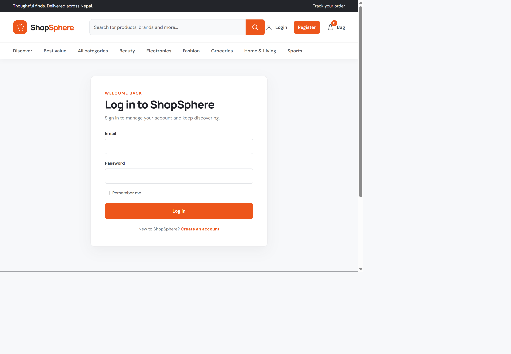

### Figure 7.5 — Customer registration

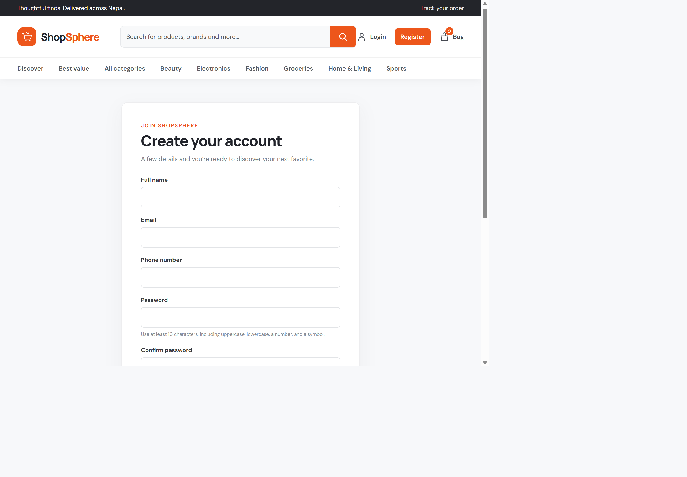

### Figure 7.6 — Shopping cart

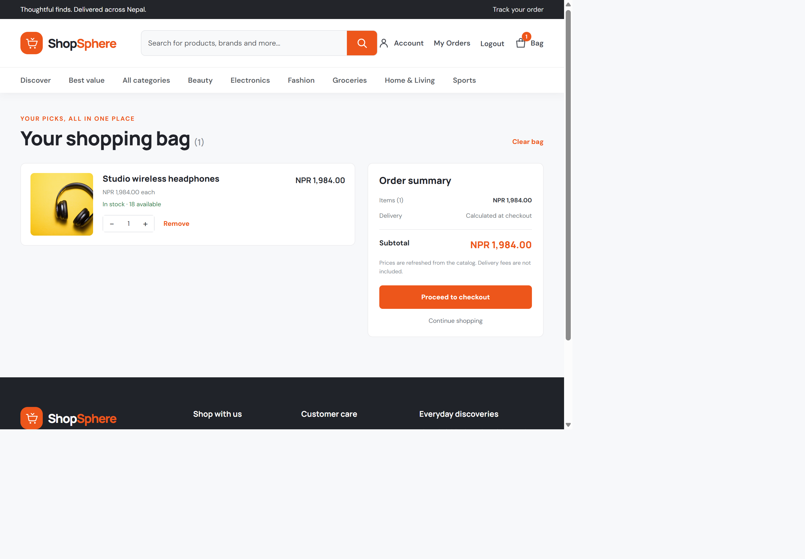

### Figure 7.7 — Checkout

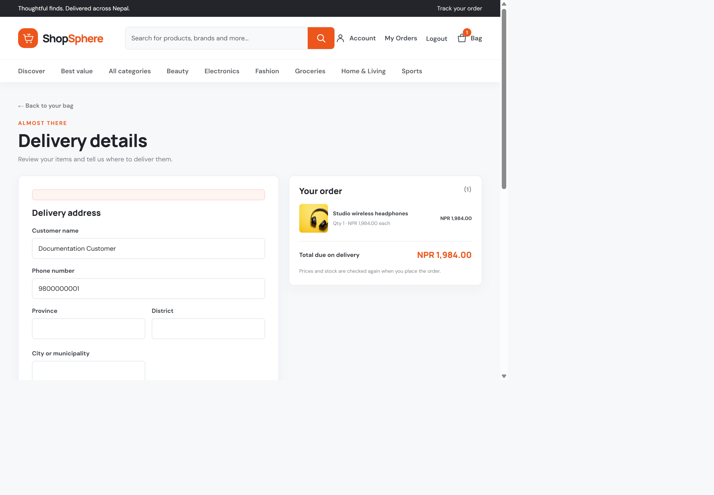

### Figure 7.8 — Customer order history

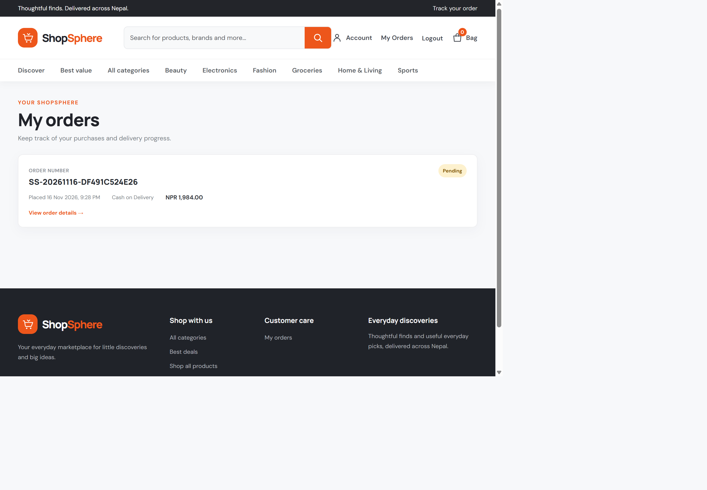

### Figure 7.9 — Admin dashboard

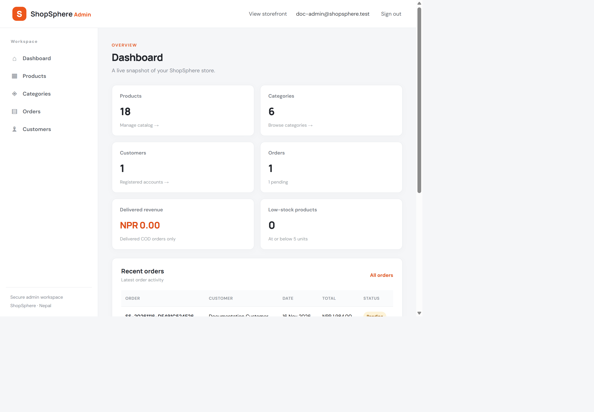

### Figure 7.10 — Admin product management

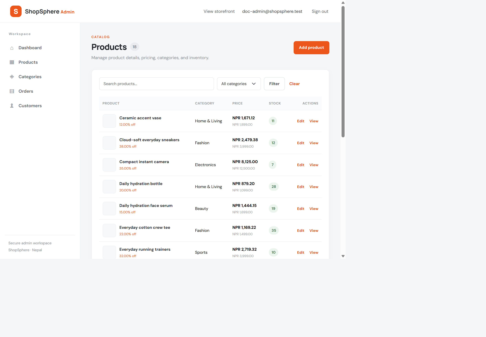

### Figure 7.11 — Admin order management

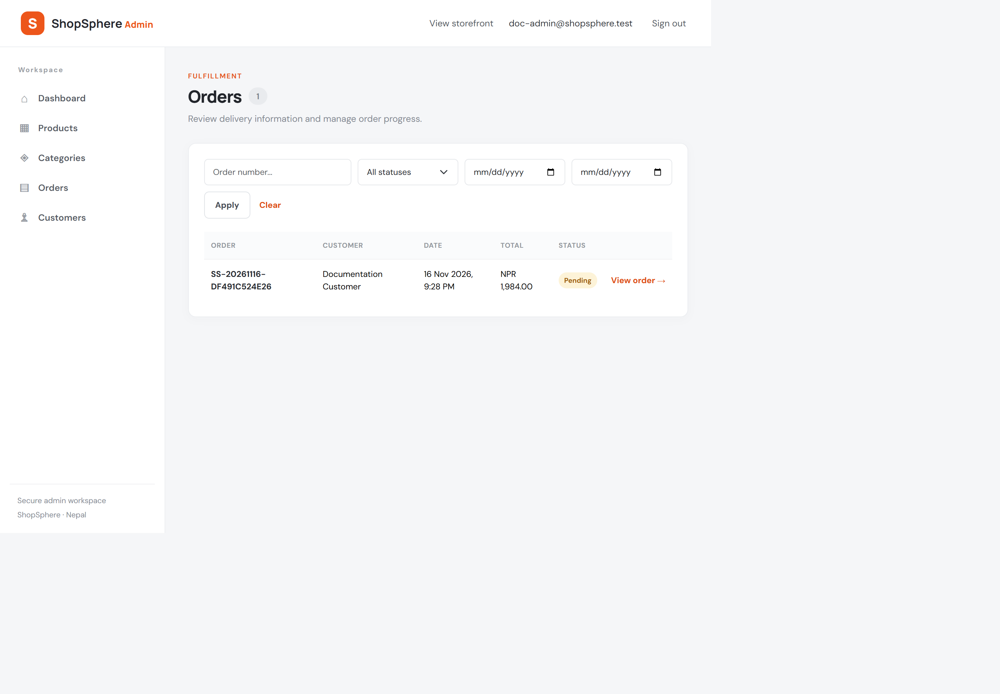

---

# Chapter 8 — Testing and Verification

## 8.1 Test approach and environment

No automated test project or test classes are present in the repository. The results below are manual browser workflow checks and a build/database verification recorded during Phase 8, supplemented by an isolated Development instance used to capture this report’s screenshots. The screenshot run used a newly created database named for documentation work, applied the existing migrations, seeded sample data, registered a temporary customer, placed one COD order and verified the Admin dashboard. That isolated database was separate from the configured personal database.

The Phase 8 manual test record reports 72 route/viewport checks across widths 1440, 1366, 768 and 390 px, no horizontal overflow or 5xx responses, and no broken images on nine storefront pages. It also reports database integrity queries with zero product/category orphans, cart/order orphans, order-total mismatches or duplicate cart products. These are recorded manual test results; they are not an automated suite or a penetration-test certification.

## 8.2 Test cases

| ID | Test | Expected result | Actual result recorded | Status |
|---|---|---|---|---|
| T-01 | Build application with `dotnet build --no-restore` | Application compiles without errors | Build succeeded with 0 warnings and 0 errors | PASS |
| T-02 | Apply migrations to an isolated SQL Server database | All four migrations create the expected schema | Migrations `InitialCreate`, `AddIdentity`, `AddShoppingCart` and `AddOrders` applied successfully to the documentation database | PASS |
| T-03 | Start Development app and load homepage | Server returns a usable page and seeded catalog | HTTP HEAD to the isolated local app returned 200; homepage rendered categories and products | PASS |
| T-04 | Development seed data | Six categories and 18 sample products appear without hard-coded view data | Browser showed six categories and 18 products in the isolated database | PASS |
| T-05 | Register, sign in and sign out | A valid customer account is created, signed in and can end its session | Manual registration/sign-in/sign-out passed in Phase 8; screenshot run also registered a temporary customer and logged in as Admin | PASS |
| T-06 | Update customer profile | Customer can update permitted profile fields | Profile update workflow passed in Phase 8 | PASS |
| T-07 | Browse catalog and product details | Products show current prices, discounts, stock, categories and related products | Product listing and product detail routes rendered from SQL Server; detail page showed related catalog item | PASS |
| T-08 | Search, category browse, filters, sorting and pagination | Query parameters constrain server-side results and are preserved while paging | Search, category, price/availability filter, sort and pagination workflows were browser-tested in Phase 8 | PASS |
| T-09 | Guest cart and sign-in merge | Guest cart persists and merges without exceeding stock | Guest-cart merge and stock-capped duplicate handling passed in Phase 8 | PASS |
| T-10 | Add item and view cart | Server accepts a valid product; navbar count and server-calculated total update | In isolated screenshot run, adding the headphone product displayed a success message and the cart showed one item at NPR 1,984.00 | PASS |
| T-11 | Update/remove/clear cart items | Quantity changes respect stock; removal and clear update totals | Cart quantity, remove and clear workflows passed in Phase 8 | PASS |
| T-12 | Place COD order | Server validates address, price and stock; order is Pending; inventory decreases and cart clears | Isolated run placed one order, showed confirmation/order number, set Pending status, and emptied the cart | PASS |
| T-13 | Repeat order submission | Same submission token does not create a duplicate order | Duplicate-order replay was browser-tested; no duplicate order was created | PASS |
| T-14 | Customer order history, detail and cancellation | Customer sees only own orders; only eligible pending order may be cancelled; stock restores once | History/detail/cancellation and single stock-restoration workflows passed in Phase 8; screenshot run showed the pending COD order | PASS |
| T-15 | Customer/guest access to Admin | Admin functions are server-protected by role | Unauthenticated `/Admin` request redirected to login; Admin account login opened the dashboard. Role protections were also inspected in source | PASS |
| T-16 | Admin dashboard values | Counts and eligible revenue come from database records | Isolated dashboard showed 18 products, 6 categories, 1 customer, 1 pending order, NPR 0.00 delivered revenue and 0 low-stock products | PASS |
| T-17 | Admin product/category CRUD and image validation | Authorized Admin can maintain catalog; invalid images and unsafe category deletion are rejected | Product upload/create/edit/delete, invalid-image rejection, category CRUD and category deletion safeguards were browser-tested in Phase 8 | PASS |
| T-18 | Admin customer and order workflows | Customer details/history are viewable; order status follows permitted transitions | Customer/order views and order status transitions through Delivered were browser-tested in Phase 8 | PASS |
| T-19 | Responsive routes and images | Layout does not overflow at target widths; pages do not return server errors | 72 route/viewport checks at 1440, 1366, 768 and 390 px reported no horizontal overflow or 5xx; nine storefront pages had no broken images | PASS |
| T-20 | Data integrity checks | No orphan records, mismatched totals or duplicate cart products remain | Isolated database integrity checks returned zero product/category orphans, cart/order orphans, total mismatches and duplicate cart products | PASS |
| T-21 | EF model and migration snapshot | The current EF model has no unrecorded changes | `dotnet ef migrations has-pending-model-changes --no-build` reported no changes since the last migration | PASS |

## 8.3 Automated testing limitation

The source repository has no unit- or integration-test project. The recorded `dotnet test` invocation exited successfully but did not execute an automated suite. All “PASS” entries above refer to manual workflow checks or the build/migration operations explicitly described in the row; they should not be interpreted as automated test coverage.

## 8.4 Security review boundary

The Phase 8 review checked authentication and role protection, password handling, antiforgery, model validation, parameterized EF queries, upload validation, customer-order ownership, server-side price/stock recalculation and duplicate-order protection. The recorded review reported no vulnerability findings. It was a source/manual review and workflow check, not a penetration test, independent security certification or assurance against undiscovered vulnerabilities.

---

# Chapter 9 — Conclusion

ShopSphere brings together a server-rendered MVC storefront, persistent SQL Server catalog, ASP.NET Core Identity, role-protected Admin pages, guest and customer carts, and transactional COD order processing. Historical order snapshots and explicit database relationships support consistent order history even when catalog records change. The project was built successfully and its documented customer, Admin, database and responsive workflows were manually exercised in isolated test data.

The implementation meets the scope of an academic e-commerce prototype. It does not process online payments, coordinate deliveries or provide automated test coverage. Those boundaries should be kept clear when presenting the application or planning a production deployment.

---

# Chapter 10 — Future Enhancements

1. Add an online payment provider with verified callbacks, reconciliation and secure payment-status transitions.
2. Integrate a delivery provider, delivery-fee rules and traceable shipment updates.
3. Add product reviews and ratings with moderation and customer-order verification.
4. Add email verification, password reset and transactional notifications.
5. Add automated unit and integration tests using an isolated test database or test provider.
6. Add reporting for sales, inventory movement and product popularity using defined business measures.
7. Add localization, currency configuration and more complete shipping/address validation.
8. Add documented privacy, return and refund policies only alongside the corresponding implemented workflows.
9. Evaluate a filtered unique normalized-email index through a safe migration after checking any existing data for duplicates.
10. Add production operations such as deployment configuration, monitoring, backups, rate limiting and explicit data-retention policies.

---

# Chapter 11 — References

1. Microsoft. “Overview of ASP.NET Core MVC.” [https://learn.microsoft.com/aspnet/core/mvc/overview?view=aspnetcore-10.0](https://learn.microsoft.com/aspnet/core/mvc/overview?view=aspnetcore-10.0)
2. Microsoft. “Introduction to Identity on ASP.NET Core.” [https://learn.microsoft.com/aspnet/core/security/authentication/identity?view=aspnetcore-10.0](https://learn.microsoft.com/aspnet/core/security/authentication/identity?view=aspnetcore-10.0)
3. Microsoft. “SQL Server Database Provider — EF Core.” [https://learn.microsoft.com/ef/core/providers/sql-server/](https://learn.microsoft.com/ef/core/providers/sql-server/)
4. Microsoft. “Entity Framework Core.” [https://learn.microsoft.com/ef/core/](https://learn.microsoft.com/ef/core/)
5. Microsoft. “SQL Server documentation.” [https://learn.microsoft.com/sql/sql-server/](https://learn.microsoft.com/sql/sql-server/)
6. Bootstrap. “Bootstrap 5 documentation.” [https://getbootstrap.com/docs/5.3/getting-started/introduction/](https://getbootstrap.com/docs/5.3/getting-started/introduction/)
7. Mermaid. “Mermaid documentation.” [https://mermaid.js.org/](https://mermaid.js.org/)
8. ShopSphere project source: [`Program.cs`](../Program.cs), [`ShopSphereDbContext.cs`](../Data/ShopSphereDbContext.cs), [`Models/`](../Models/), [`Controllers/`](../Controllers/), [`Areas/Admin/`](../Areas/Admin/), [`Views/`](../Views/), [`Services/`](../Services/) and [`Migrations/`](../Migrations/).

---

**End of report**
